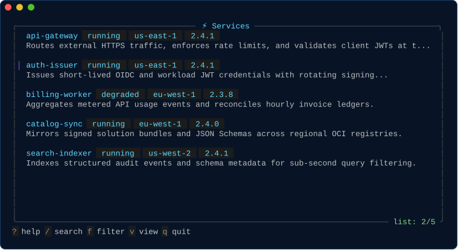
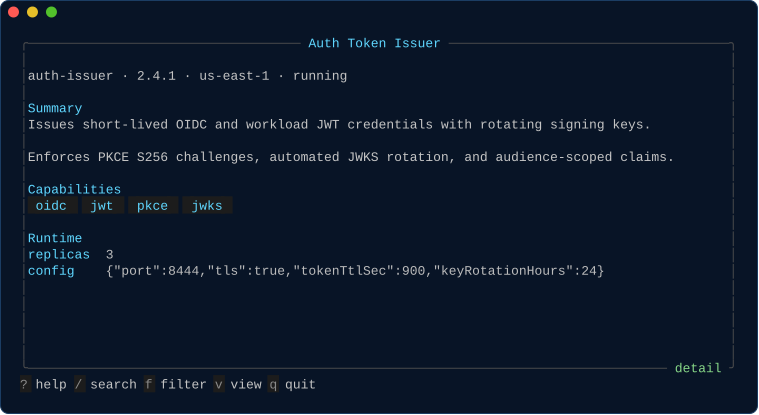
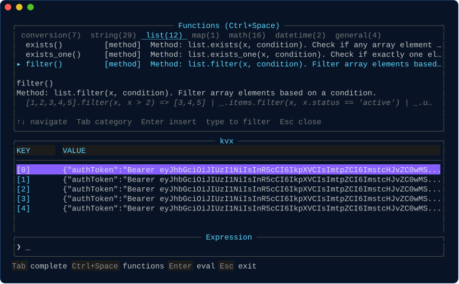
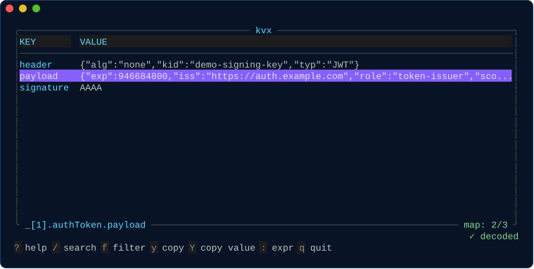
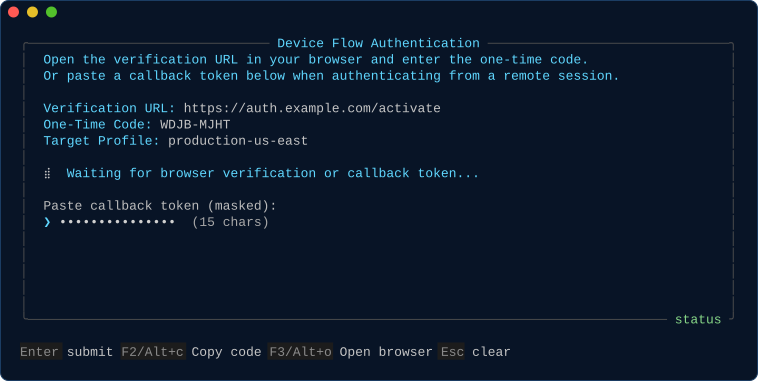
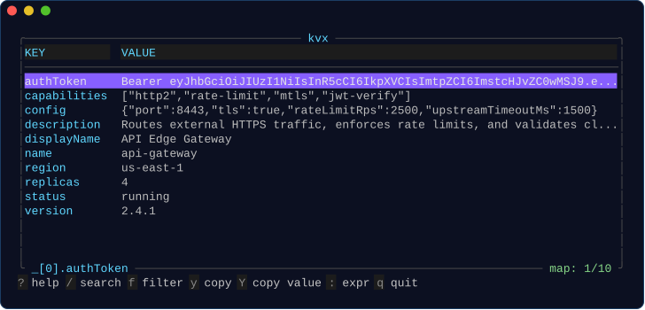
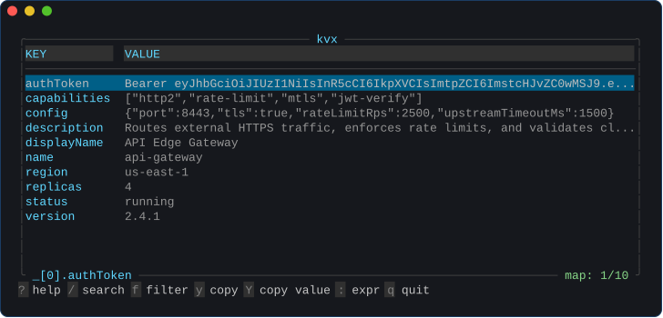
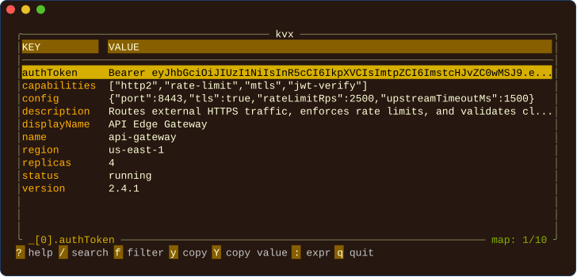
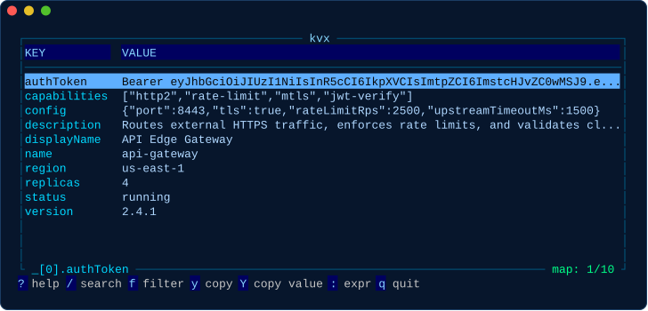
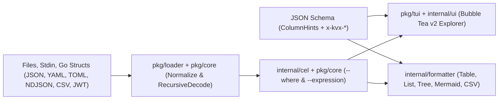

# kvx

[](https://kvx.oakwood-commons.org/)
[](https://pkg.go.dev/github.com/oakwood-commons/kvx)
[](https://goreportcard.com/report/github.com/oakwood-commons/kvx)
[](https://github.com/oakwood-commons/kvx/actions/workflows/ci.yml)
[](https://codecov.io/gh/oakwood-commons/kvx)
[](https://github.com/oakwood-commons/kvx/releases)
[](LICENSE)

Interactive terminal UI, schema-driven explorer, and [CEL](https://cel.dev/) query engine for JSON, YAML, TOML, NDJSON, CSV, and JWT data. Use `kvx` as a standalone CLI or embed `pkg/tui` and `pkg/core` directly in your own Go applications.

<p align="center">
  
</p>

> **Pre-1.0 Notice**: `kvx` is under active development. Minor releases may refine CLI flags or Go library interfaces; breaking changes are called out in [Release Notes](https://github.com/oakwood-commons/kvx/releases). Questions or ideas? Start a [Discussion](https://github.com/oakwood-commons/kvx/discussions).

## Highlights

- **Interactive TUI (`-i`)**: Navigate deeply nested trees (`j`/`k`/`l`/`h`), filter keys as you type, run deep recursive searches (`/`), copy highlighted CEL paths immediately with `y` (`Alt+w` / `F5`), or copy values with `Y` (`Alt+W`) as raw scalars or pretty-printed JSON.
- **Schema-Driven Views (`--schema`)**: Render arrays and objects as scrollable Card Lists (`x-kvx-list`), Sectioned Detail views (`x-kvx-detail` with newline-preserving paragraphs and typed-slice pill badges), or Async Waiting Screens (`x-kvx-status` with hotkeys and masked inline input), and press `v` (`Alt+v` / `F2`) on any schema view to toggle the raw table.
- **JWT & Nested String Decoding**: Auto-detect 6 input formats including `Bearer` JWT tokens, press `Enter` on any serialized JSON/YAML/TOML/NDJSON/JWT string leaf to expand it in place, or pass `--auto-decode lazy|eager` on the CLI.
- **CEL Querying & Function Palette**: Filter lists per item with `-w/--where`, transform data with `-e/--expression` or `:` in the TUI, accept inline ghost completions, and browse categorized CEL functions via `Ctrl+Space`.
- **10 Output Modes & Custom Column Order**: `auto` (width-aware table with automatic list fallback), `table`, `list`, `tree`, `mermaid`, `yaml`, `json`, `toml` (with automatic `[[items]]` root-slice wrapping), `csv`, and `raw`, plus `--column-order` across maps, columnar tables, and vertical lists.
- **Embeddable Go Packages**: Thread-safe headless querying and table rendering (`pkg/core` + `pkg/tui`) plus full Bubble Tea v2 TUI embedding and deterministic `--snapshot` testing.

## Installation

```bash
# macOS / Linux (Homebrew)
brew install oakwood-commons/tap/kvx

# Windows (winget)
winget install OakwoodCommons.kvx

# Go toolchain (Go 1.27+)
go install github.com/oakwood-commons/kvx@latest
```

Prebuilt signed archives for Linux, macOS, and Windows (`x86_64` and `arm64`) are also available on [GitHub Releases](https://github.com/oakwood-commons/kvx/releases/latest).

## Quick CLI Tour

```bash
# Auto-sized table (falls back to vertical list on narrow terminals)
kvx examples/data/demo_services.json

# Interactive TUI with schema-driven Card-List and Detail views
kvx examples/data/demo_services.json --schema examples/data/demo_services_schema.json -i

# Filter list items with --where (-w), then project fields with --expression (-e)
kvx examples/data/demo_services.json \
  -w '_.status == "running" && _.replicas >= 3' \
  -e '_.map(s, {"service": s.name, "region": s.region})'

# Recursively decode serialized JSON and Bearer JWT strings before querying
kvx examples/data/demo_services.json \
  --auto-decode eager \
  -e '_[1].authToken.payload' \
  -o yaml

# Render ASCII trees or Mermaid flowcharts
kvx tests/sample.yaml -o tree --tree-depth 3
kvx tests/sample.yaml -o mermaid --mermaid-direction LR

# Deterministic TUI snapshot with scripted startup keys (CI-safe)
kvx examples/data/demo_services.json --snapshot --width 92 --height 22 --press "jl<Enter>"
```

## Visual TUI Walkthrough

### Schema Card-List (`x-kvx-list`) & Sectioned Detail (`x-kvx-detail`)

Attach a JSON Schema with `x-kvx-*` vendor extensions (`--schema`) to turn arrays of objects into badged Card Lists and multi-layout Detail screens (`inline`, `paragraph`, `tags`, and `table` sections). Press `v` (`Alt+v` / `F2`) at any time to switch between the schema view and the raw `KEY`/`VALUE` table.

<table>
  <tr>
    <td width="50%">
      
      <p align="center"><sub>Card-List view (<code>x-kvx-list</code>)</sub></p>
    </td>
    <td width="50%">
      
      <p align="center"><sub>Sectioned Detail view (<code>x-kvx-detail</code>)</sub></p>
    </td>
  </tr>
</table>

### CEL Expression Mode & `Ctrl+Space` Function Palette

Press `:` to evaluate CEL interactively with inline ghost completions (`Right` to accept, `Tab` to cycle keys) and press `Ctrl+Space` to open the categorized Function Palette with type-to-filter search, signatures, and runnable examples:

<p align="center">
  
</p>

### JWT & Nested String Decoding + Async Status Screens

Press `Enter` on any string leaf containing serialized JSON, YAML, TOML, NDJSON, or a `Bearer` JWT to inspect its decoded structure in place, or use `x-kvx-status` to drive device-code and callback waiting screens with hotkeys and masked inline input:

<table>
  <tr>
    <td width="50%">
      
      <p align="center"><sub>Decoded <code>Bearer</code> JWT claims (<code>Enter</code>)</sub></p>
    </td>
    <td width="50%">
      
      <p align="center"><sub>Async Status Screen (<code>x-kvx-status</code>)</sub></p>
    </td>
  </tr>
</table>

### Built-In Theme Presets

Switch palettes with `--theme <name>` (or customize colors under `ui.themes` in `~/.config/kvx/config.yaml`; list available presets with `kvx config theme`):

<table>
  <tr>
    <td width="50%">
      
      <p align="center"><sub><code>midnight</code> (default)</sub></p>
    </td>
    <td width="50%">
      
      <p align="center"><sub><code>dark</code></sub></p>
    </td>
  </tr>
  <tr>
    <td width="50%">
      
      <p align="center"><sub><code>warm</code></sub></p>
    </td>
    <td width="50%">
      
      <p align="center"><sub><code>cool</code></sub></p>
    </td>
  </tr>
</table>

## Keybindings (`vim`, `emacs`, `function`)

Select your preferred keymap with `--keymap vim|emacs|function` (or `ui.features.key_mode` in `config.yaml`):

| Action | Vim (`default`) | Emacs | Function |
|--------|-----------------|-------|----------|
| Move down / up | `j` / `k` (`Down` / `Up`) | `Ctrl+N` / `Ctrl+P` | `Down` / `Up` |
| Drill in / decode string leaf | `l`, `Enter` (`Right`) | `Ctrl+F`, `Enter` | `Enter` (`Right`) |
| Ascend to parent | `h` (`Left`) | `Ctrl+B` | `Left` |
| Top / bottom | `gg` / `G` | `Alt+<` / `Alt+>` | `Home` / `End` |
| Toggle schema view vs raw table | `v` | `Alt+v` | `F2` |
| Deep search (`keys` + `values`) | `/` (`n` / `N`) | `Ctrl+S` | `F3` |
| Filter map keys | `f` | `Ctrl+L` | `F4` |
| Copy path / Copy value | `y` / `Y` | `Alt+w` / `Alt+W` | `F5` / *(unbound)* |
| CEL Expression / Function Palette | `:` / `Ctrl+Space` | `Alt+x` / `Ctrl+Space` | `F6` / `Ctrl+Space` |
| Help / Close context / Quit | `?` / `Esc` / `q` | `F1` / `Esc` / `Ctrl+Q` | `F1` / `Esc` / `F10` |

## Go Library Quickstart (`pkg/core` + `pkg/tui`)

```go
package main

import (
	"log"

	"github.com/oakwood-commons/kvx/pkg/core"
	"github.com/oakwood-commons/kvx/pkg/tui"
)

func main() {
	root, err := core.LoadFile("examples/data/demo_services.json") // or core.LoadObject(myStructs)
	if err != nil {
		log.Fatal(err)
	}
	cfg := tui.DefaultConfig()
	cfg.AppName = "my-cli"
	if err := tui.Run(root, cfg); err != nil { // or tui.RenderTable(root, tui.TableOptions{Bordered: true})
		log.Fatal(err)
	}
}
```

Explore runnable Go examples in [`examples/display_schema`](examples/display_schema), [`examples/schema_hints`](examples/schema_hints), [`examples/status-screen`](examples/status-screen), [`examples/column_order`](examples/column_order), [`examples/custom_struct`](examples/custom_struct), and [`examples/core-cli`](examples/core-cli).

## Architecture



## Documentation

Full guides and API references are published at **[kvx.oakwood-commons.org](https://kvx.oakwood-commons.org/)**:

- [Getting Started](https://kvx.oakwood-commons.org/docs/tutorials/getting-started/)
- [Interactive Mode](https://kvx.oakwood-commons.org/docs/tutorials/interactive-mode/)
- [CEL Expressions & Function Palette](https://kvx.oakwood-commons.org/docs/tutorials/expressions/)
- [Formats, JWTs & Serialized Decoding](https://kvx.oakwood-commons.org/docs/tutorials/formats-and-decoding/)
- [Schema-Driven Views (`x-kvx-list`, `x-kvx-detail`, `x-kvx-status`)](https://kvx.oakwood-commons.org/docs/tutorials/schema-views/)
- [Configuration & Theme Gallery](https://kvx.oakwood-commons.org/docs/tutorials/configuration/)
- [Library Usage (`pkg/core` + `pkg/tui`)](https://kvx.oakwood-commons.org/docs/library-usage/) & [Embedding Guide](https://kvx.oakwood-commons.org/docs/embedding/)

## License

Apache License 2.0. See [LICENSE](LICENSE) for details.
