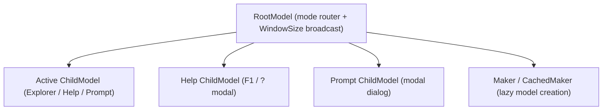

# Embedding kvx in Another Go Application

`kvx` is architected so host CLIs (such as `scafctl`) can embed interactive data exploration, schema-driven catalogs, async waiting screens, and deterministic TUI snapshots without shelling out to a separate binary.

## Choosing Your Integration Seam

| Seam | Entry Point | When to Use |
|------|-------------|-------------|
| **Full Interactive Viewer** | `tui.Run(root, cfg, opts...)` | Launch a turnkey interactive explorer for command output, API responses, or provider catalogs |
| **Deterministic Frame Snapshot** | `tui.RenderSnapshot(root, cfg)` | Test TUI views in `go test` or render non-interactive previews with `cfg.StartKeys` |
| **Static Multi-Format Output** | `tui.Render` / `tui.RenderTable` | Emit CLI tables (`FormatAuto`, `FormatTable`), lists, trees, or Mermaid diagrams with visual parity |
| **Headless Data & CEL Engine** | `core.New()` / `core.LoadObject` | Evaluate `--expression` and `--where` flags or normalize Go structs with zero Bubble Tea dependency |

## Minimal Interactive Embed

Always normalize typed Go structs and typed slices (`[]MyStruct`, `[]map[string]string`) with `core.LoadObject` before passing them to `tui.Run` or `tui.RenderSnapshot`:

```go
package main

import (
	"log"

	"github.com/oakwood-commons/kvx/pkg/core"
	"github.com/oakwood-commons/kvx/pkg/tui"
)

func main() {
	payload := map[string]any{
		"service":  "catalog-sync",
		"replicas": 2,
		"regions":  []string{"us-east-1", "eu-west-1"},
	}

	root, err := core.LoadObject(payload)
	if err != nil {
		log.Fatalf("load object: %v", err)
	}

	cfg := tui.DefaultConfig()
	cfg.AppName = "my-cli"
	cfg.ThemeName = "midnight"
	cfg.AutoDecode = "lazy" // allow automatic scalar decoding on navigate

	if err := tui.Run(root, cfg); err != nil {
		log.Fatalf("run tui: %v", err)
	}
}
```

Pass custom `io.Reader` / `io.Writer` streams in tests or alternate TTYs via `tui.WithIO(in, out)...` as variadic `tea.ProgramOption` arguments to `tui.Run`.

## Wiring Schema-Driven Catalogs & Status Screens

Attach a `DisplaySchema` parsed from JSON Schema `x-kvx-*` extensions (`tui.ParseSchemaWithDisplay`) or constructed in Go (`tui.DisplaySchema`):

- **`DisplaySchema.List` (`x-kvx-list`)**: Renders root object slices as scrollable cards with badges and subtitles (`examples/display_schema`).
- **`DisplaySchema.Detail` (`x-kvx-detail`)**: Renders drilled-in objects using `inline`, `paragraph`, `tags`, and `table` sections. Users can still press `v` (`Alt+v` / `F2`) to inspect the raw table unless disabled.
- **`DisplaySchema.Status` (`x-kvx-status`)**: Renders an async waiting screen wired to `cfg.Done` (`<-chan tui.StatusResult`), `cfg.OnStatusInput` (for inline masked or unmasked token submission), and `cfg.OpenURL` (`examples/status-screen`).

## Customizing CEL Functions & Intellisense

Build a `*cel.Env` containing `_` (`cel.Variable("_", cel.DynType)`) plus your application's custom functions, wrap it with `tui.NewCELExpressionProvider(env, exampleHints)`, and assign `cfg.ExpressionProvider` on `tui.Config` (prefer `cfg.ExpressionProvider` over the process-global `tui.SetExpressionProvider` when multiple commands share a binary). Your custom functions automatically participate in live evaluation, ghost completions, and the `Ctrl+Space` Function Palette.

## Internal `ChildModel` Composition Architecture

Inside `internal/ui`, `kvx` organizes interactive Bubble Tea v2 components around a composable **tree-of-models** pattern (`ChildModel`, `RootModel`, and `Maker`) inspired by modular TUI architectures:



- **`ChildModel` (`internal/ui/child_model.go`)**: Minimal lifecycle contract (`Init() tea.Cmd`, `Update(tea.Msg) (ChildModel, tea.Cmd)`, `View() string`) implemented by focused sub-models (`internal/ui/explorer`, `HelpModel`, and `PromptModel`) so each view can be unit-tested in isolation without spinning up a full terminal program.
- **Optional capability interfaces**: Child models opt into richer shell coordination by implementing `ModelWithID`, `ModelWithTitle`, `ModelWithBorder`, `ModelWithSize` (`SetSize(width, height)`), and `ModelWithFocus` (`Focus() tea.Cmd`, `Blur()`, `Focused() bool`).
- **`RootModel` (`internal/ui/root_model.go`)**: Maintains the active UI `Mode` (`NormalMode`, `ExprMode`, `SearchMode`, `HelpMode`, `PromptMode`), swallows `tea.KeyReleaseMsg` events so modifiers never double-fire, broadcasts `tea.WindowSizeMsg` resizes, and manages back-navigation via a `ChildModel` stack (`NavigateTo` / `NavigateBack`).
- **`Maker` & `CachedMaker` (`internal/ui/maker.go`)**: Lazily instantiates child models by route/path ID on demand and optionally caches stateful views across navigation transitions.

## Concurrency Notes for Host Applications

`tui.Run` drives a single interactive terminal session and should not be run concurrently in the same terminal. For concurrent background or server-side rendering, `tui.RenderTable`, `tui.RenderList`, `tui.RenderTree`, `tui.RenderMermaid`, and `core.Engine` (`Evaluate`, `Rows`, `FilterWhere`, `EvaluateWhere`) isolate per-call render state and are verified under `CGO_ENABLED=1 go test -race ./...`.
